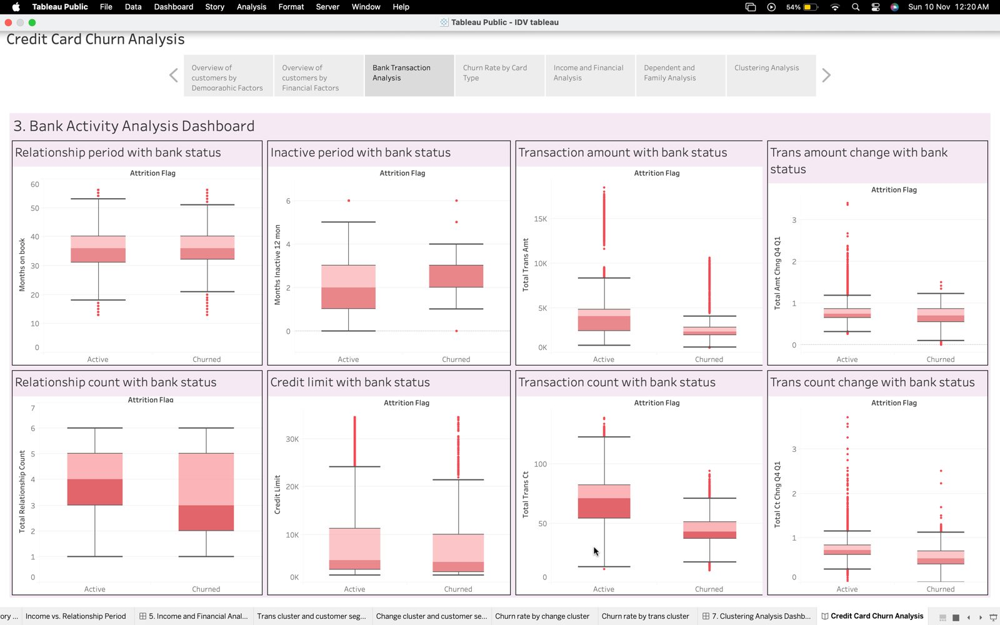
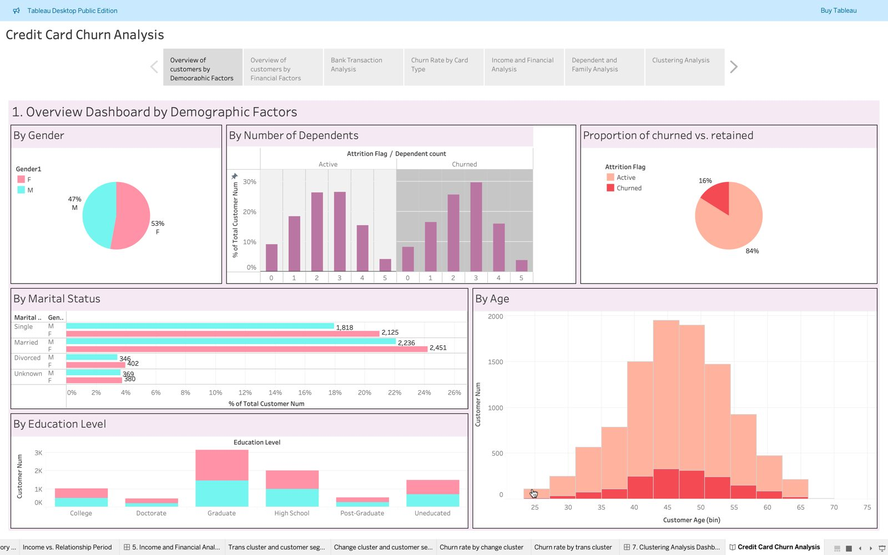
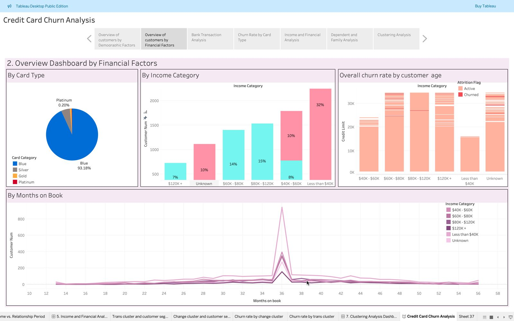
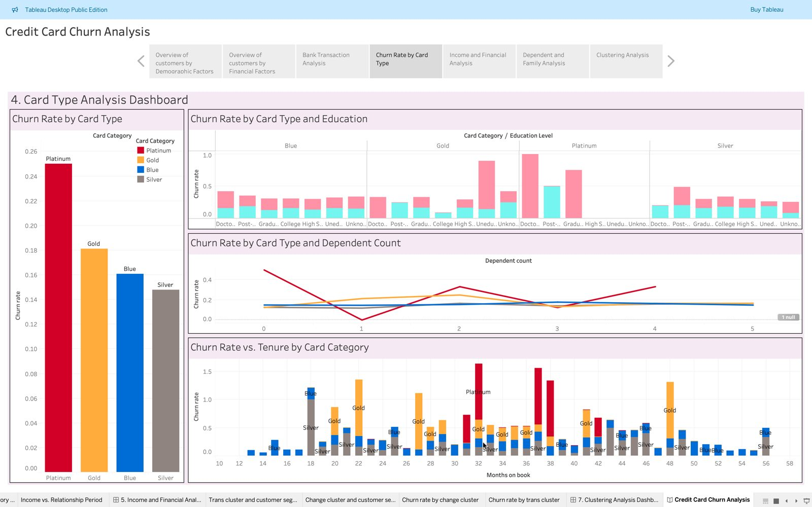
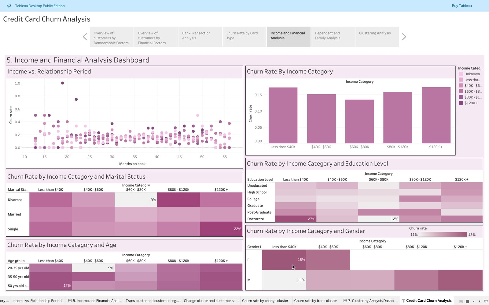
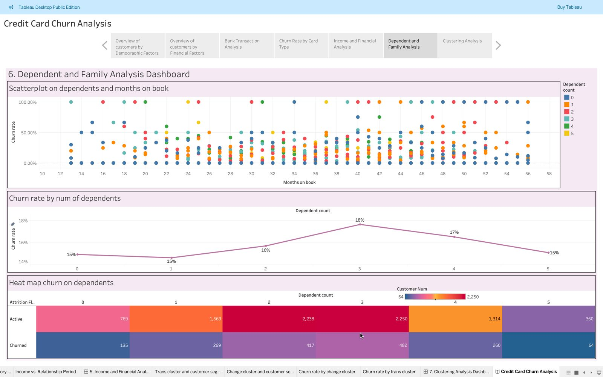
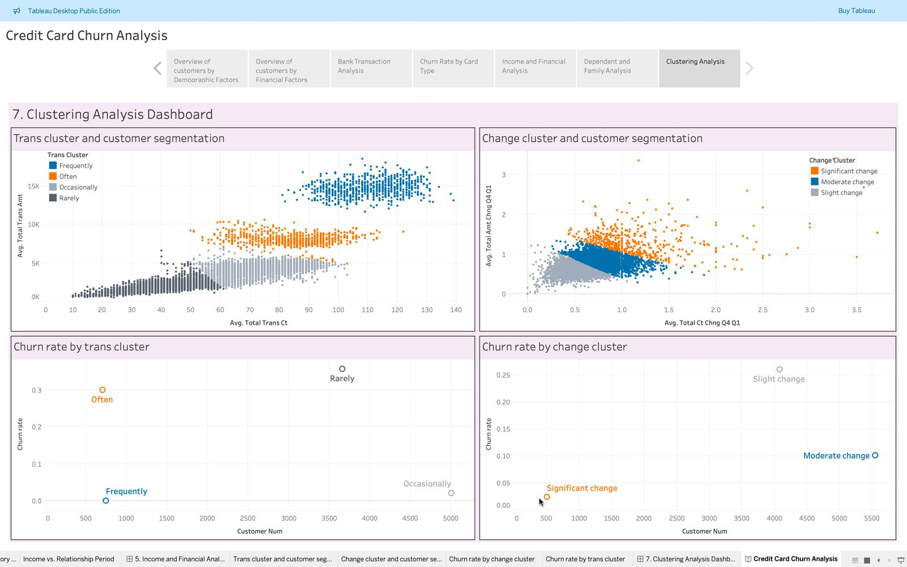

# Predicting Credit Card Customer Attrition: Interactive Churn Analysis in Tableau


Interactive data visualization project that looks at **why credit card customers leave a bank**. It uses **7 linked Tableau dashboards** to find high-risk customer segments and turns those findings into a **data-driven retention strategy**.

> Course project for **Interactive Data Visualization** at **DA-IICT** (Nov 2024), supervised by Prof. Bhaskar Choudhary.
> **Team (Group 11):** Prince Titiya · Hiten Gondaliya · Jyoti Kumari

---

## Business Problem

A bank's credit card portfolio is losing customers. **About 1 in 6 customers (16.07%) have already churned.** Keeping an existing customer costs much less than winning a new one, so the bank needs to know:

1. **Who** is most likely to leave (which demographic and financial segments)?
2. **What behaviour** shows up before a customer leaves?
3. **What should the bank do** to keep them?

## Dataset

| Property | Value |
|---|---|
| Records | 10,127 credit card customers |
| Features | 21 (demographic, account and transaction behaviour) |
| Target | `Attrition_Flag`: Existing (8,500) vs Attrited (1,627) |
| Class balance | 83.9% retained / **16.1% churned** (imbalanced) |

**Feature groups**
- **Demographic:** age, gender, dependents, education, marital status, income bracket
- **Account / relationship:** card category, months on book (tenure), number of bank products held, credit limit
- **Behavioural:** inactive months, contacts with the bank, transaction count and amount, Q4→Q1 change in spend and frequency, revolving balance, utilization ratio

> Note: the last two columns (`Naive_Bayes_Classifier_...`) are artefacts from the original data source and were **excluded** from the analysis.

### Derived Fields (Tableau calculated fields)
| Field | Logic | Purpose |
|---|---|---|
| `Churn Rate` | `SUM(IF Attrition_Flag="Attrited Customer" THEN 1 ELSE 0) / COUNT(Attrition_Flag)` | Core KPI for every view |
| `Customer Num` | `COUNTD(CLIENTNUM)` | Distinct customer count per segment |
| `% of Total` | `Customer Num / TOTAL(Customer Num)` | Normalizes segments for fair comparison |
| `Age Group` | ≤35 / 36–50 / 50+ | Age-based segmentation |
| `Trans Cluster` | Clustering on transaction count & amount → *Frequently / Often / Occasionally / Rarely* | Behavioural segmentation |
| `Change Cluster` | Clustering on Q4→Q1 count & amount change → *Significant / Moderate / Slight change* | Detecting sudden drops in activity |

## Approach

1. **Framed hypotheses** before building any charts:
   - **H1:** Card type affects churn (entry-level vs premium).
   - **H2:** Income, gender, education and dependents affect churn.
   - **H3:** Longer tenure means lower churn.
   - **H4:** Targeted interventions on the segments found can reduce churn.
2. **Data preparation:** cleaned and profiled the data, then created calculated fields and customer segments in Tableau.
3. **Visual analysis:** built 7 interactive dashboards with filters, a navigation story and cross-chart actions. Chart types include box plots, heatmaps, stacked/grouped bars, scatter clusters and histograms.
4. **Design evaluation:** each chart was assessed on visualization principles (mark/channel choice, separability, pop-out, scalability and expressiveness).
5. **Insight → strategy:** turned the findings into retention actions for specific segments.

## Dashboards

| # | Dashboard | Question it answers |
|---|---|---|
| 1 | Demographic Factors | Does churn differ by age, gender, marital status, education or dependents? |
| 2 | Financial Factors | How do card type, income and tenure split the customer base? |
| 3 | Bank Activity Analysis | How do churned and active customers differ in engagement? (box plots) |
| 4 | Card Type Analysis | Which card tiers churn most, and how does that interact with education, dependents and tenure? |
| 5 | Income & Financial Analysis | Which income × marital / education / age / gender combinations are high risk? (heatmaps) |
| 6 | Dependent & Family Analysis | How does family size relate to churn? |
| 7 | Customer Segmentation (Clustering) | Which transaction behaviour clusters have the highest churn? |

<details open>
<summary><b>Bank Activity Analysis: the clearest view of churn drivers</b></summary>


</details>

<details>
<summary><b>View the other dashboards</b></summary>

**Demographic Factors**


**Financial Factors**


**Card Type Analysis**


**Income & Financial Analysis**


**Dependent & Family Analysis**


**Customer Segmentation / Clustering**

</details>

## Key Findings

**Behavioural engagement is the strongest signal. Demographics matter much less.**

| Signal | Churned customers | Retained customers |
|---|---|---|
| Median transactions / year | **43** | 71 |
| Median transaction amount / year | **$2,329** | $4,100 |
| Median revolving balance | **$0** | $1,364 |
| Median Q4→Q1 transaction count change | **0.53** | 0.72 |

| Segment | Churn rate | vs. 16.1% baseline |
|---|---|---|
| Holds only 1–2 bank products | **26–28%** | ~1.7× |
| Holds 6 bank products | 10.5% | Much lower |
| 4 inactive months in last year | **29.9%** | ~1.9× |
| 1 inactive month in last year | 4.5% | Much lower |
| 5+ contacts with the bank in a year | **33.5%+** (100% at 6 contacts) | 2×+ |
| 0 contacts with the bank | 1.8% | Much lower |
| Platinum cardholders | 25.0% (small group, n=20) | 1.6× |
| Doctorate / Post-Graduate | 21.1% / 17.8% | Higher |
| Female customers | 17.4% (vs 14.6% male) | Slightly higher |
| Income < $40K and $120K+ | ~17.2% | Both ends of income range |

**What the hypotheses showed**
- **H1 (card type), partly supported:** churn is highest in *premium* Platinum cards, the opposite of what we expected. The Platinum group is small, so this needs more data before it can be trusted.
- **H2 (demographics), partly supported:** churn is higher at **both income extremes**, among highly educated customers, among women, and among customers with 3–4 dependents. These effects are small compared with the behavioural ones.
- **H3 (tenure), not supported:** median tenure is **36 months for both groups**. Tenure alone does not predict churn.
- **Main insight:** declining **engagement** (fewer transactions, falling activity from Q4 to Q1, inactivity, few products, frequent support contacts) is the most reliable early warning of churn.

## Proposed Retention Strategy

| Risk signal | Proposed action |
|---|---|
| **Falling transaction activity** (Q4→Q1 drop, "Rarely" or "Significant change" clusters) | Set up an **early-warning trigger**: when spend or frequency drops sharply, send personalised cashback or spend-based offers within 30 days. |
| **2–3+ inactive months** | Re-activation campaigns, such as bonus rewards on the next transaction or bill-pay and auto-pay incentives. |
| **Frequent contacts with the bank (4+)** | Treat as a **complaint signal**. Route to a priority service team, fix issues on first contact and run a follow-up satisfaction check. |
| **Low product holding (1–2 products)** | **Cross-sell** savings accounts, loans or insurance. More products tie the customer to the bank and lower churn (10.5% at 6 products). |
| **Zero revolving balance / low utilization** | Offer EMI conversions, balance-transfer offers and usage-based rewards to make the card part of daily spending. |
| **Platinum / premium cardholders** | Review the premium value proposition: exclusive perks, a dedicated relationship manager, and fee waivers tied to usage. |
| **Income extremes** | **< $40K:** low-fee or fee-waiver plans and budgeting tools. **$120K+:** tiered loyalty rewards and travel/lifestyle benefits. |
| **Larger families (3–4 dependents)** | Family-oriented offers such as add-on cards and rewards on education, groceries and healthcare. |

**Rollout idea:** score customers on the engagement signals above, focus outreach on the highest-risk group, and A/B test offers to measure how much churn each one actually prevents.

## Repository Structure

```
├── Group11_Dataset.csv            # Raw dataset (10,127 customers)
├── Group11_Visualization.twbx     # Packaged Tableau workbook (7 dashboards + story)
├── Group11_ProjectReport.pdf      # Full 54-page report: design rationale & chart-by-chart analysis
├── group11.pptx                   # Final presentation
└── images/                        # Dashboard screenshots used in this README
```

## How to Explore

1. Install [Tableau Public](https://public.tableau.com/app/discover) (free) or Tableau Desktop.
2. Open `Group11_Visualization.twbx`. The data is packaged inside the workbook.
3. Start from the **"Credit Card Churn Analysis"** story and use the filters and chart actions to drill into segments.

## Skills Demonstrated

`Data Visualization` · `Tableau (calculated fields, table calculations, clustering, dashboard actions, story points)` · `Exploratory Data Analysis` · `Customer Segmentation` · `Churn / Retention Analytics` · `Hypothesis-driven Analysis` · `Business Storytelling & Recommendations`
